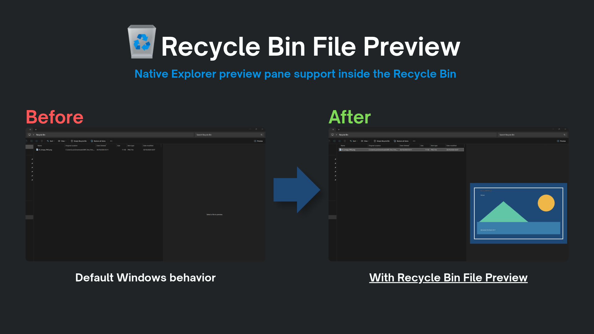

# Recycle Bin File Preview

Enable the native **Windows File Explorer Preview Pane (Alt + P)** for files
in the Recycle Bin, without restoring them.

*Before: the default Recycle Bin view. After: the same file can be previewed
with Recycle Bin File Preview enabled.*

## Features

- Preview supported files in the Recycle Bin without restoring them.
- Uses the built-in File Explorer Preview Pane, not a separate window.
- Uses the preview handlers and file associations already installed on your PC.
- Automatically tries normal file associations when the Recycle Bin does not provide them.
- Does not modify, restore, or delete your files.
- No setup needed after installation. Debug logging is optional and off by default.

## Installation

1. Install [Windhawk](https://windhawk.net/) if you do not already have it.
2. Open the [Recycle Bin File Preview page](https://windhawk.net/mods/recycle-bin-file-preview), or search for **Recycle Bin File Preview** in Windhawk.
3. Click **Install**.

## How to use

1. Open the **Recycle Bin** in File Explorer.
2. Press **Alt + P** to show the Preview Pane.
3. Select a deleted file to preview it.

There are no extra steps or settings required.

## Compatibility and limitations

- A file can be previewed only if Windows has a compatible preview handler for that file type. Some formats may show **No preview available**.
- This mod does not install codecs or new preview handlers.
- Deleted folders cannot be opened or browsed with this mod.
- Windows updates may affect how File Explorer and its preview handlers work.

## Troubleshooting

If a supported file does not show a preview, first check whether the same file type can be previewed in a normal Explorer folder.

To collect more details, enable **Debug logging** in the mod settings, reproduce the issue, and check the Windhawk log for messages starting with `RBP:`. Turn logging off again after testing.

If you find a bug, [open an issue](https://github.com/luizbizzio/recycle-bin-file-preview/issues) and include your Windows version, the file type, and any relevant logs.

## Author and license

**Luiz Bizzio**. Licensed under **MIT**; see [LICENSE](LICENSE).
